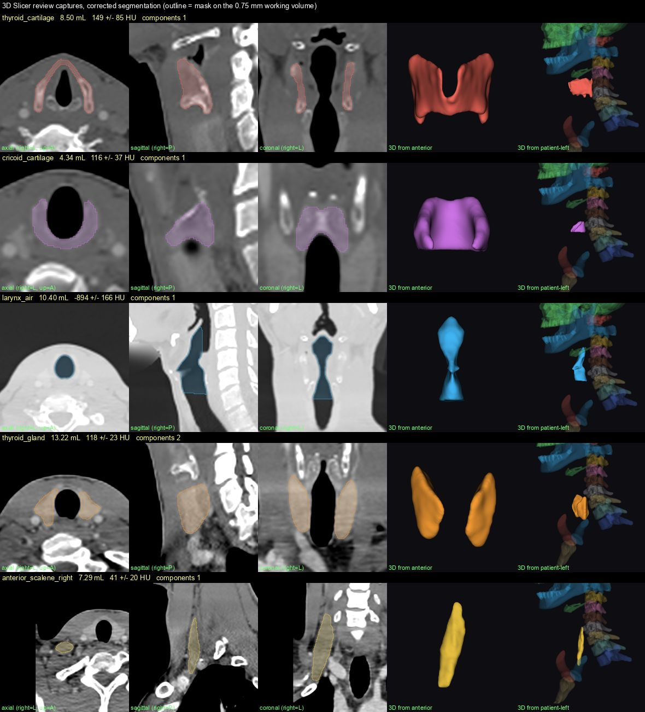
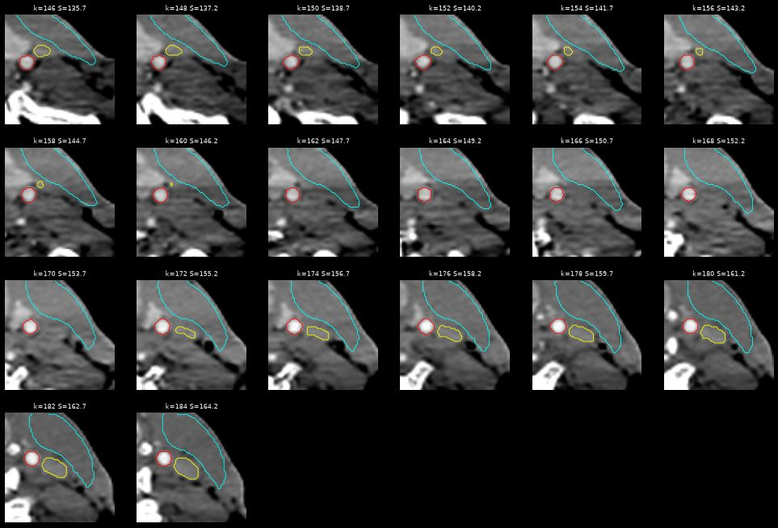
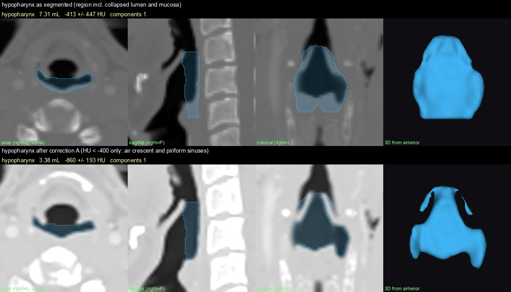
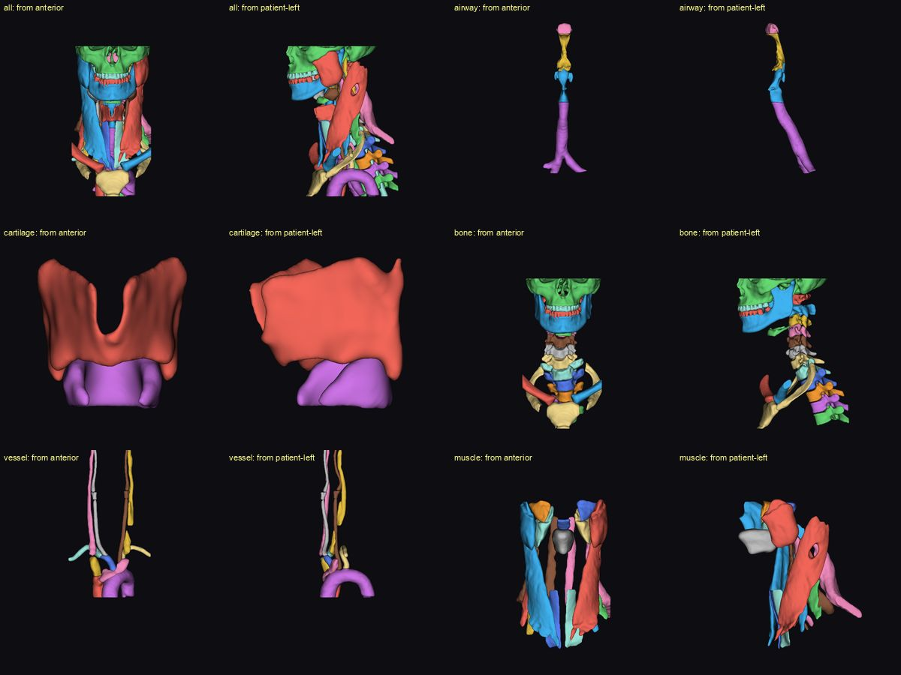
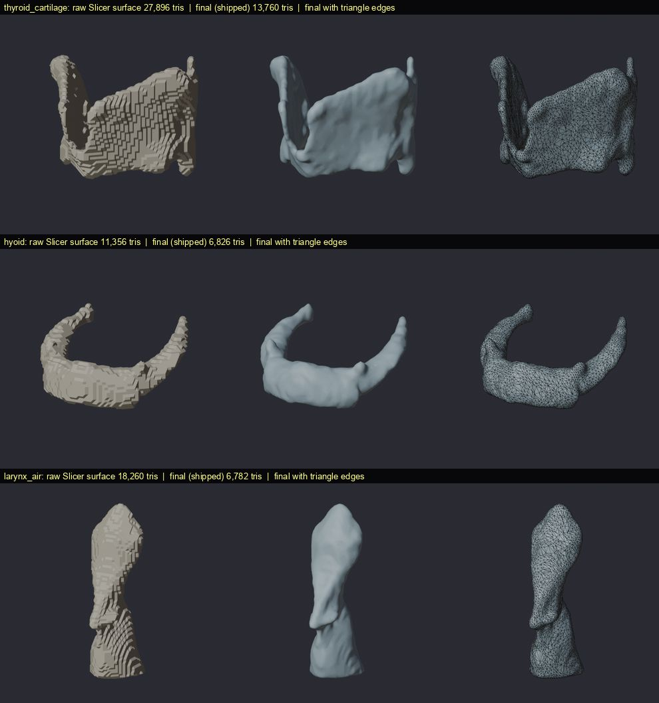
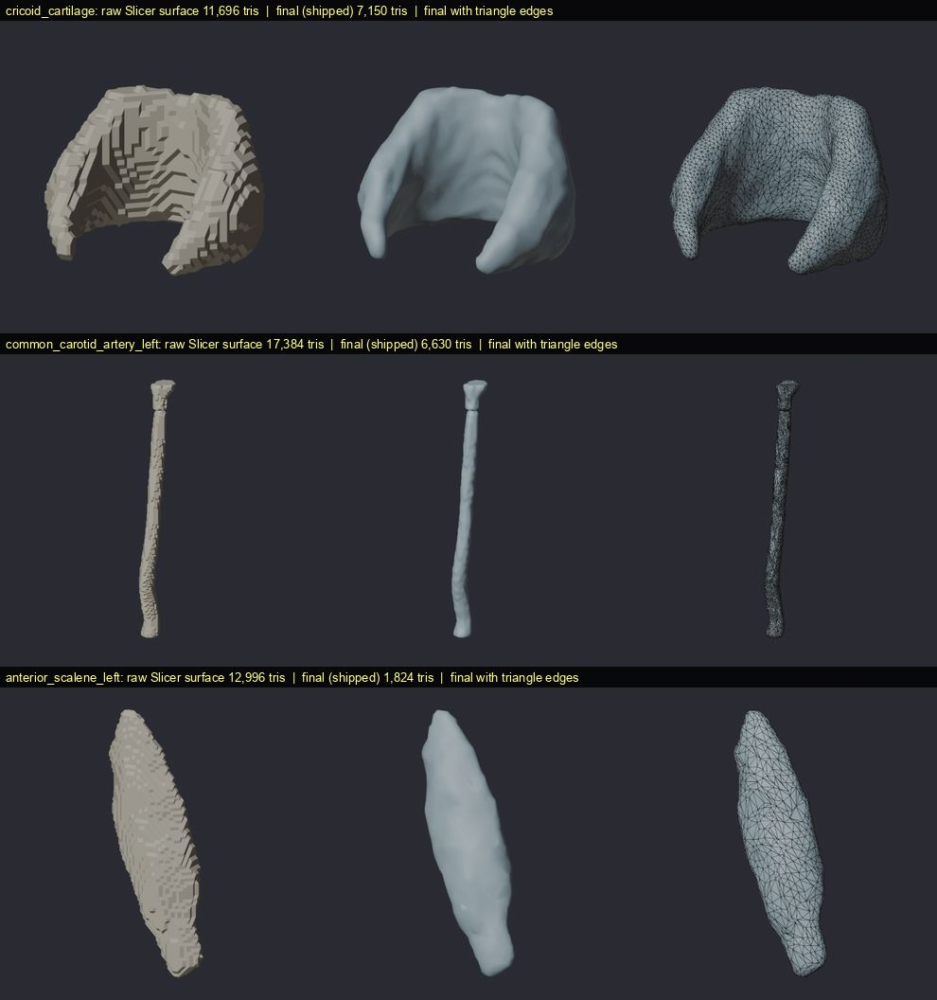
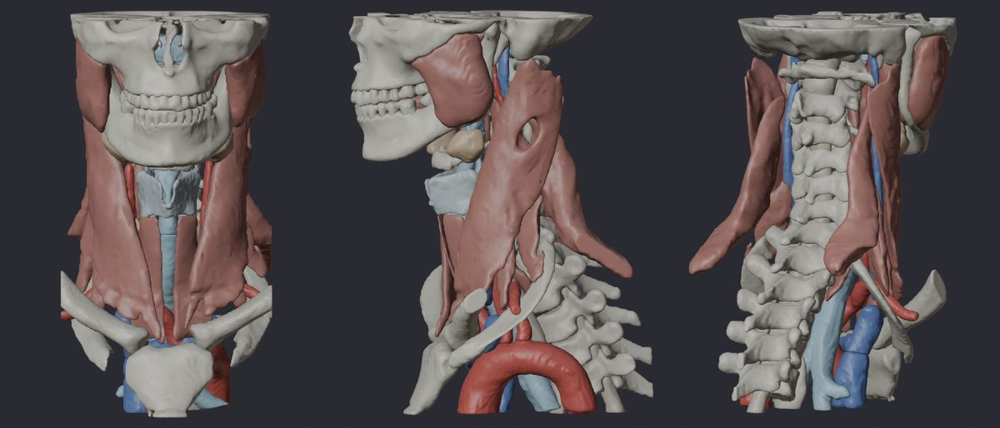
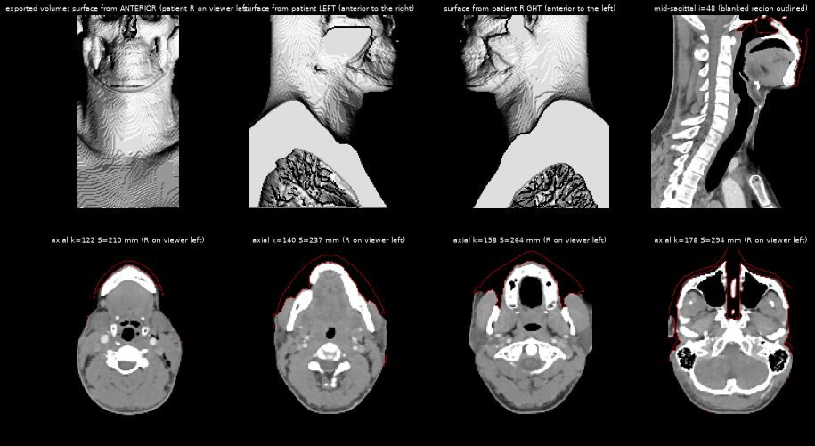
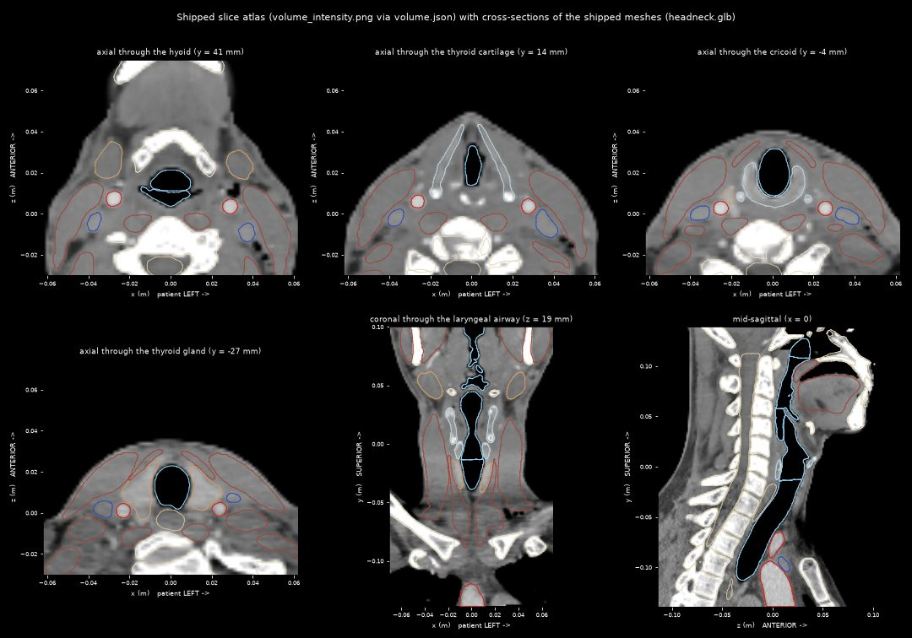

# Head-and-neck CT assets: TotalSegmentator, 3D Slicer, Blender

Record for `assets/models/headneck/` (produced 2026-11-11). Everything here was measured or run on this machine; where
something was not done, was approximated, or failed, it says so.

**What this is not.** The review was done by an AI assistant looking at 3D Slicer overlays and at numbers. No radiologist,
anatomist or clinician has checked these structures. Teaching illustration only.

## 1. Deliverables

| File | Size | Content |
|---|---:|---|
| `assets/models/headneck/headneck.glb` | 1,099,132 B | 68 meshes, 379,976 triangles, Draco, one node per structure (node name = structure id, identity transform, `extras`: id, display_name, group, side), 8 plain materials by group |
| `assets/models/headneck/structures.json` | 175 KB | one record per exported structure, the 56 excluded classes with reasons, the 65 classes that were empty in this scan |
| `assets/models/headneck/volume.json` | 23 KB | grid, voxel→frame affine, atlas layout, HU lookup table, label table, crop, defacing |
| `assets/models/headneck/volume_intensity.png` | 1,253,803 B | 185 axial slices of 98 × 152 voxels, 8-bit, 16 tiles per row (1568 × 1824 px) |
| `assets/models/headneck/volume_labels.png` | 100,187 B | same grid and layout; pixel value = `label_id` (0 = none) |
| `tools/headneck/` | 332 KB | the scripts that were run, in order, plus `registry.json`, `14_decisions.json`, `14_review_notes.json` |
| `docs/overlord-world/headneck/` | 788 KB | nine review images used below |

Attribution that must be displayed wherever the assets are shown or redistributed:

> CT data: TotalSegmentator dataset v3.0.0, subject s0527, J. Wasserthal et al., University Hospital Basel,
> CC BY 4.0, doi:10.5281/zenodo.22688904. Structures: TotalSegmentator 2.18.0 (Wasserthal et al., Radiology: Artificial
> Intelligence 2023, doi:10.1148/ryai.230024), reviewed and modified. Not validated by a clinician.

Using it in the browser:

- Frame: metres, right-handed, **X = patient LEFT, Y = SUPERIOR, Z = ANTERIOR**. `X = 0` is the patient's mid-sagittal
  plane; the slice volume is centred on the origin in Y and Z.
- Voxel centre `(i, j, k)` → frame: `x = -0.0015·i + 0.071951`, `y = 0.0015·k - 0.138000`, `z = 0.0015·j - 0.113254`
  (the same numbers are `grid.voxel_to_frame` in `volume.json`). `i` runs towards patient right, `j` anterior, `k` superior.
- Atlas pixel of voxel `(i, j, k)`: `px = (k mod 16)·98 + i`, `py = floor(k / 16)·152 + j`, counted from the image's top-left.
  Slice `k = 0` is the lowest. Sample with nearest filtering for labels.
- Intensity bytes are not linear in HU: use `intensity.lut` (`byte_to_hu` has all 256 values). Soft tissue (−160…240 HU)
  has 2.5 HU steps, bone (240…1840 HU) 25 HU steps, air 32 HU steps.
- Meshes reach up to 0.2 mm outside the volume box where a structure is cut by the scan boundary.

## 2. Tool evaluation

**TotalSegmentator 2.18.0** (PyPI release of 2026-08-12, Apache-2.0) with nnU-Net 2.8.1, PyTorch 2.15.0, Python 3.11.15 in a
`uv` environment outside the repository. The registry of the installed package (dumped to `tools/headneck/registry.json`)
has 53 tasks and 425 distinct classes; 35 tasks are open, 18 need a licence key.

- Works as documented on this Mac. `--device mps` gave **voxel-identical** masks to `--device cpu` on
  `headneck_bones_vessels` (12 of 12 classes, 0 differing voxels) and predicted in 58 s instead of 254 s, so MPS was used.
- Open-task weights (2.9 GB for the tasks used) download from the project's GitHub releases without an account. The README
  states them as "openly available for any usage (Apache-2.0 license)".
- It sends anonymous usage statistics by default (a random id, task name, platform). This was switched off before the
  first run with the documented `send_usage_stats: false` setting.
- Each task resamples to its own model grid (1.5 mm for `total`, 0.75 × 0.75 × 1 mm for the head-and-neck tasks, 0.5 mm for
  `craniofacial_structures`) and returns masks on the input grid.
- The classes are regions as a radiotherapy or radiology annotator would draw them, not teaching anatomy: `hypopharynx`
  includes collapsed lumen and mucosa, `spinal_cord` is the whole spinal canal content, `skull` (task `total`) includes
  the mandible and teeth, and two tasks can claim the same voxel.
- As a production tool for this exhibit it is useful for bone, air, enhanced vessels and large muscles. It is not
  enough on its own: 56 of 124 non-empty classes were excluded here, mostly because of this scan's field of view and
  1.5 mm resolution, and the airway classes needed correction.

**MCP server** (`totalseg_mcp`, part of the `[mcp]` extra; 349 lines). It offers eight tools over stdio or unauthenticated
HTTP: `list_all_classes`, `get_class_options`, `list_all_tasks`, `get_task_details`, `get_modality`,
`detect_contrast_phase`, `estimate_body_statistics`, `run_segmentation`. It was started over stdio from
`tools/headneck/03_mcp_probe.py` with the MCP Python SDK; no Claude, IDE or Cursor configuration was read or changed.

| Call | Result |
|---|---|
| `list_all_tasks`, `get_task_details`, `list_all_classes` | 53 tasks, 425 classes; same data as the registry |
| `get_class_options(["brachial_plexus"])`, `(["vagus_nerve", …])` | tool error. The server log says `ValueError: Unknown classes`; the client only receives "Error executing tool get_class_options" |
| `get_modality` | `ct` (2 to 3 s) |
| `detect_contrast_phase` | `arterial_late`, 30.6 s post injection, probability 1.0 (79 to 104 s) |
| `run_segmentation` (task `total`, speed `fast`, 4 classes, statistics on) | **failed** on a new output folder: 2.18.0 opens `statistics.json` before it creates the folder (`FileNotFoundError`). With the folder created beforehand the same call finished in 23 s |
| the masks from that call (3 mm model) against the standard run | Dice: trachea 0.95, spinal canal 0.93, C5 0.89, thyroid gland 0.88 |
| `run_segmentation` (task `face`) | tool error, as expected: licence required |
| `estimate_body_statistics` | not called (needs a licence key) |

Conclusion: the server is a thin wrapper that shells out to the same command-line tool. It helps an interactive agent
find tasks and classes. It was not used to produce these assets, because it does not expose options this job used
(`-ho` logits resampling at standard speed, extended statistics `-sx`), reports errors without their cause, has the
statistics bug above, and a full-resolution run can outlast a client's tool timeout.

**Licence-gated tasks, not used and no key obtained:** `heartchambers_highres`, `appendicular_bones`,
`appendicular_bones_mr`, `tissue_types`, `tissue_types_mr`, `tissue_4_types`, `face`, `face_mr`, `brain_structures`,
`thigh_shoulder_muscles`, `thigh_shoulder_muscles_mr`, `coronary_arteries`, `coronary_arteries_LEGACY`, `aortic_sinuses`,
`renal_arteries`, `aorta_annulus`, `aortic_dissection`, `pulmonary_artery_landmarks`; also the body-statistics and
aorta-report commands. Consequence here: no `face` mask, so defacing was done with our own rule (section 8).

**3D Slicer 5.13.0-2026-11-09** (revision b5d5d9e, native arm64). The stable release on download.slicer.org (5.12.4) is
x86_64 only; the arm64 build is the official *preview* build, so that one was used (SHA-512 of the download matched the
value the download service reports). It lives in `~/Developer/overlord-asset-sources/tools/Slicer.app`, was never
installed, and ran the review, the corrections and the mesh export from scripts.

**Blender 5.1.2** ran the mesh clean-up and the Draco GLB export headless.

## 3. What TotalSegmentator does and does not contain

Evidence: `tools/headneck/registry.json` (from the installed package) and the MCP calls above.

- **No brachial plexus. No peripheral nerve of the neck or arm** (no vagus, phrenic, recurrent laryngeal, accessory,
  hypoglossal, cervical or brachial plexus roots, trunks or cords). The only nervous-system classes in all 53 tasks are
  `spinal_cord` (`total`, `total_mr`), `optic_nerve_left/right` (`head_glands_cavities`, `oculomotor_muscles`) and the brain
  classes. Names such as `brachiocephalic_trunk`, `*_alveolar_canal` or `auditory_canal_*` are vessels or bony canals.
- Also absent, and therefore absent from this exhibit: epiglottis, arytenoid cartilages, vocal folds, tracheal rings,
  tonsils, subclavian veins, external carotid artery, external and anterior jugular veins, vertebral arteries, lymph nodes.
- Present and used: trachea, laryngeal airway, three pharyngeal lumen regions, thyroid and cricoid cartilage, hyoid,
  mandible, teeth, skull, palate, vertebrae, first ribs, clavicles, sternum, carotid, subclavian and brachiocephalic
  arteries, internal jugular and brachiocephalic veins, superior vena cava, thyroid and submandibular glands, neck and
  jaw muscles, esophagus, spinal canal.

## 4. Dataset

| | |
|---|---|
| Source | "Dataset with segmentations of 117 important anatomical structures in 1939 CT images", version 3.0.0, Jakob Wasserthal, University Hospital Basel. Zenodo record 22688904, published 2026-09-10 |
| DOI | 10.5281/zenodo.22688904 (all versions: 10.5281/zenodo.6802613) |
| Subject | `s0527`. Metadata row: age 30, male, institute J, study type "ct angiography neck", Siemens SOMATOM Definition AS+, 120 kVp, kernel i30f, source slice thickness 2 mm, pathology "no_pathology", split "train" |
| File | `Totalsegmentator_dataset_v300/s0527/ct.nii.gz`, 3,850,015 bytes, SHA-256 `3a636ccb30d690222e665b41de952ba4118567c827dd4bd31a5f66fbc215a989` |
| Geometry | 98 × 152 × 209 voxels, **1.5 mm isotropic** (the publisher resampled every scan to 1.5 mm), −1157…3085 HU, axis codes R, A, S |
| Licence | Creative Commons Attribution 4.0 International, https://creativecommons.org/licenses/by/4.0/legalcode. Allows copying, redistribution and adaptation for any purpose with credit, a link to the licence and an indication of changes |
| Citation asked for | Wasserthal et al., "TotalSegmentator: Robust Segmentation of 104 Anatomic Structures in CT Images", Radiology: Artificial Intelligence 2023, doi:10.1148/ryai.230024 |
| How it was fetched | HTTP range requests into the 37.4 GB zip on Zenodo: the central directory, `meta.csv`, this subject's CT and its 117 label files, and the CT of 16 other candidates (2 to 17 MB each). The archive itself was not downloaded |

De-identification, as stated by the publisher and as found:

- Paper: images were sampled from the University Hospital Basel PACS (2012, 2016, 2020) under an ethics waiver of the
  Ethics Committee Northwest and Central Switzerland (EKNZ BASEC Req-2022-00495).
- Repository, `resources/train_nnunet.md`: "TotalSegmentator is trained on images without blurred faces. Your dataset
  contains blurred faces."
- The files are NIfTI with ids `sNNNN`; the metadata table holds age, sex, an institute letter, scanner, kVp, kernel,
  slice thickness and a pathology category, and nothing else.
- Found in this subject: the anterior facial surface is smoothed. A surface rendering shows no nose, lip or eye contour.
- Gap: the Zenodo page itself has no sentence that says "de-identified"; the face-blurring statement is in the
  repository of the same author.

Two properties of this subject that matter:

- It is in the dataset's `train` split, so the `total` model has very probably been trained on this scan. Agreement
  with the publisher's labels (section 6) is a consistency check, not an independent validation.
- The published affine is oblique by 1.51° and its float32 direction cosines are not orthonormal enough for ITK or
  3D Slicer to open the file. See section 9 for how the frame was defined.

Inspected and rejected (header data for all, images for those marked *):

| Candidate | Licence | Why not |
|---|---|---|
| IDC v25, head-and-neck cancer collections | | no CT in IDC (`cptac_hnscc`, `tcga_hnsc` hold pathology slides and SEG only). Restricted-access sources were not pursued |
| IDC `cptac_luad` C3N-02948, "CT NECK W IV CONTRAST", 0.55 × 0.55 × 1.5 mm * | CC BY 4.0 | the publisher blanked 78 slices (117 mm) through the face, so nothing above the mandible; extensive enlarged cervical and mediastinal lymph nodes distort the neck |
| IDC `eay131` EAY131-7978834, neck 1 mm | CC BY 4.0 | only 156 of about 430 slice positions present, gaps up to 51 mm |
| IDC `varepop_apollo` AP-RMFZ, neck 0.64 × 0.64 × 2 mm * | CC BY 4.0 | starts at the mandible; asymmetric supraglottic airway in a head-and-neck cancer cohort; 2 mm slices |
| IDC `eay131` EAY131-1569955, 0.53 × 0.53 × 1 mm * | CC BY 4.0 | a chest series: nothing above the thoracic inlet; one missing slice |
| IDC `tcga_thca` neck CTs | CC BY 3.0 | thyroid cancer patients; 3 mm slices (header only) |
| IDC PET/CT "skull base to thigh" series | CC BY 3.0 / 4.0 | attenuation CT, 3.75 to 5 mm, no contrast (header only) |
| IDC `covid_19_ny_sbu` A072894, trauma CT angiography | CC BY 4.0 | 0.98 mm pixels, 658 MB; not fetched (header only) |
| Zenodo s1071, s0870 * | CC BY 4.0 | dental streak artefact through the oropharynx (heavy in s0870); s0870 ends at the thoracic inlet |
| Zenodo s0642 * | CC BY 4.0 | no contrast; starts at C2 |
| Zenodo s0263, s0453, s0504 * | CC BY 4.0 | bone-kernel noise; s0504 only 122 mm wide |
| Zenodo s0259, s0744 and eight "chest-neck" scans (s0847, s0890, s0897, s0898, s0914, s0941, s0999, s1067) * | CC BY 4.0 | partial neck (s0259), head only (s0744), chest-centred series |

No candidate combined a redistributable licence, sub-millimetre resolution, full coverage and a normal neck. s0527 has the
licence, a publisher-blurred face, coverage from above the orbits to the carina, contrast (arterial-late), an open airway,
no dental artefact, a straight head and no recorded pathology. Its costs are the 1.5 mm resolution and a narrow field of
view (147 mm wide), which cuts the shoulders.

## 5. Segmentation

Working volume: every published voxel split 2 × 2 × 2 (cubic B-spline, clamped to the published HU range) to 0.75 mm,
196 × 304 × 418 voxels. This adds no information. It lets the head-and-neck models, which work at 0.75 mm, return masks on
a finer lattice than 1.5 mm. All masks, statistics and meshes are on this grid.

```
TotalSegmentator -i ct_075.nii.gz -o masks/<task> -ta <task> -d mps -ho -s -sx -sii -rp masks/<task>/run_report.json
```

| Task | Classes | With voxels | Runtime (MPS, M4 Pro) |
|---|---:|---:|---:|
| `total` | 117 | 53 | 154 s |
| `headneck_bones_vessels` | 12 | 12 | 77 s |
| `headneck_muscles` | 23 | 23 | 163 s |
| `head_glands_cavities` | 19 | 18 | 74 s |
| `head_muscles` | 11 | 11 | 111 s |
| `craniofacial_structures` | 7 | 7 | 354 s |
| | 189 | 124 | 933 s |

Open tasks that were not run: `total_v3` (in the registry, not in the README), `body` (skin; never wanted), `teeth`,
`vertebrae_pp`, `vertebrae_body`, `oculomotor_muscles` and the tasks for other body regions.

## 6. Review in 3D Slicer

All 124 non-empty classes were loaded with the CT into one Slicer segmentation (`12_slicer_review_raw.py`). For each one
Slicer wrote slice overlays in three planes (through the largest cross-section) and two 3D views, and these numbers:
voxel count, volume, centroid, bounding box, 26-connected components, HU mean, SD and percentiles, voxels touching each
face of the volume, side of the midline. Slicer's own Segment Statistics module was run as a cross-check. Overlaps
between tasks and Dice against the publisher's labels (task `total` only) were computed in the same session. The
overlays of all 124 classes were then looked at, structure by structure, and again after the corrections for the
structures that changed.



Findings that decided things:

- **Orientation.** Every `_left` class lies on the patient-left side of the midline and every `_right` class on the right
  (all sided classes; 34 of them are in the exported set). Independent of those labels, the aortic arch lies left
  (+16.9 mm), the superior vena cava right (−19.0 mm) and the esophagus left (+9.3 mm) of the midline, as in normal
  anatomy.
- **Tissue density.** Air lumina −860 to −930 HU after correction; bone 201 HU (sternum) to 795 HU (mandible), vertebrae
  308 to 539 HU, teeth 1400 HU; arteries 125 to 182 HU; veins only 57 to 135 HU (arterial-late phase); thyroid gland
  118 HU; muscle 34 to 69 HU; ossified thyroid cartilage 149 HU, unossified cricoid 116 HU.
- **Agreement with the publisher's labels** (before corrections; not independent, see section 4): trachea 0.96,
  vertebrae C1 to T5 0.93 to 0.96, aorta 0.97, superior vena cava 0.96, esophagus 0.94, spinal canal 0.94,
  thyroid gland 0.93, subclavian arteries 0.92 and 0.93, clavicles 0.92, first ribs 0.91 and 0.92, sternum 0.90,
  left brachiocephalic vein 0.90, common carotid arteries 0.85 and 0.87 (6 mm vessels on a 1.5 mm grid).
- **Field of view.** 37 classes touch a lateral, posterior, anterior or top border of the image and 18 the lower end of
  the scan.
  The narrow scan cuts lungs, ribs 2 to 6, trapezius, deep back muscles, left parotid gland and both clavicles.
- **Thin sheets.** Platysma, the three pharyngeal constrictors and thyrohyoid are 1.9 to 2.7 mm thick, less than two
  published voxels, and border tissue of the same density. Their position comes from the model's prior.
- **Seams between models.** `larynx_air` and `trachea` come from different models and both taper to a dome, leaving
  0.96 mL of unlabeled air between them. In the same way `common_carotid_artery_*` (task `total`) stops 13.5 mm below
  `internal_carotid_artery_*` (task `headneck_bones_vessels`) on both sides, although the enhanced artery is plain to see.
  Both seams were closed (corrections B and B2).
- **Seams left open.** The internal jugular masks end 3.4 mm (right) and 7.7 mm (left) from the brachiocephalic vein
  masks; the venous angle and the subclavian vein are not classes and the veins are weakly opacified, so nothing was
  added. Muscle masks stop 2 to 11 mm short of bone because tendons and attachments are not segmented. The first ribs
  end 2.2 and 5.5 mm from T1.
- **Left internal jugular vein.** The mask has an 8 mm gap at the C7 level. HU along the expected path falls to muscle
  level (55 to 59 HU), so the image does not support tracing the vein there. It was **not** bridged.

  
- **Left sternocleidomastoid.** A through-notch at the C3 level surrounds air-density pockets in the left upper lateral
  neck that open to the skin surface. The mask follows the image and was left as it is. What the pockets are was not
  established.
- **Thyroid gland.** Two separate lobes; the isthmus is not resolved.
- Levels in this subject: hyoid at C4, thyroid cartilage at C5 to C6, cricoid at C6 to C7, thyroid gland at C7 to T1.

Result: **124 classes segmented, 68 exported (50 accepted unchanged, 18 corrected), 56 excluded.** The per-structure
finding is the `review.note` of each record in `structures.json`.

### Corrections

Made in Slicer's Segment Editor from `14_slicer_corrections.py`; every change with voxel counts is in
`structures.json` (`review.corrections`). No smoothing, margin or interpolation was applied to any mask.

| Step | Segment Editor effects | Structures | Reason | Change |
|---|---|---|---|---|
| A | Threshold (HU < −400) into a helper, Logical operators: intersect | trachea, larynx_air, hypopharynx, oropharynx, nasopharynx | a lumen must be air; the model's regions include mucosa and collapsed lumen | −3.1 %, −16.7 %, **−53.7 %**, −20.0 %, −7.8 % of voxels |
| B | helper segment drawn at voxel coordinates, Logical operators: union | trachea | seam between two models | +0.96 mL; the lumen from nasopharynx to main bronchi is now one connected body |
| B2 | helper segment of voxels ≥ 120 HU inside a 9 mm tube between the two masks, Logical operators: union | common_carotid_artery_left, _right | seam between two models: 13.5 mm of plainly enhanced artery (distal common carotid and bulb, 175 to 180 HU) lay unlabeled below the internal carotid mask | +0.87 mL, +0.82 mL; common and internal carotid masks now meet. The top 2 to 3 mm may be past the bifurcation |
| C | box helper, Logical operators: subtract | skull | exhibit boundary and privacy: nothing above the temporomandibular joints | 386 → 176 mL |
| D | Logical operators: subtract, by fixed priority (air > cartilage and bone > arteries > veins > glands > esophagus and canal > muscle) | 16 pairs claimed by two models | one voxel, one structure | largest: hard palate out of skull (6,010 voxels), thyroid gland out of right sternothyroid (446); the rest 2 to 295 voxels |
| E | Islands: remove small islands (< 200 voxels); keep largest island (skull) | thyroid_cartilage, vertebrae_T5, skull | stray fragments; fragments left by cut C | −60, −14, −1,239 voxels |



After the corrections no voxel belongs to two structures. The corrected segmentation is
`~/Developer/overlord-asset-sources/totalsegmentator/review/slicer/TS_corrected.seg.nrrd` (raw: `TS_raw.seg.nrrd`).



### Exclusions (56 classes; each with its reason in `structures.json` → `excluded`)

- **Cut by the field of view (28):** lung lobes (4), ribs 2 to 6 (10), costal cartilages, right scapula, T6, T7, heart,
  brain, trapezius (2), deep back muscles (2), temporalis (2), left parotid gland, frontal sinuses.
- **Too thin or too small for 1.5 mm (13):** platysma (2), pharyngeal constrictors (3), thyrohyoid (2), posterior
  scalene (2; left to right volume ratio 2.8), styloid processes (2), nasal cavities (2; sheet-like, mucosa included).
- **Publisher-blurred zone (2):** anterior bellies of digastric.
- **Outside the airway and neck scope or privacy (12):** eyes (2), lens, optic nerves (2), ear canals (2), zygomatic
  arches (2), maxillary sinuses, right parotid gland (its left partner is cut), and `head`, the outer surface of the
  head, which is never exported.
- **Duplicate (1):** `skull` of task `total`, which contains the mandible and teeth; the `craniofacial_structures` skull
  was used instead.

Kept although cut, and flagged in `mask.cut_by_field_of_view`: both clavicles (medial 58 and 62 mm only), the lateral ends
of both subclavian arteries, the left first rib (75 border voxels), the left levator scapulae (4.8 cm² cut face), the
spinous tips of T4 and T5, and the structures that run through the lower end of the scan (trachea and bronchi, esophagus,
spinal canal, aortic arch, superior vena cava, sternum).

### Finding per exported structure

Same text as `review.note` in `structures.json`. "Published voxel" means the scan's 1.5 mm voxel.

**Airway lumen**

- `trachea` (corrected): Air column from the lower cricoid border to the carina and into both main bronchi, which are cut by the lower scan boundary. Dice 0.96 against the publisher's label (before corrections). Corrected: HU mask removed 3.1 % of voxels; 0.96 mL of unlabeled lumen at the larynx seam added.
- `larynx_air` (corrected): Hourglass lumen from just above the hyoid to the lower cricoid border; narrowest (98 mm2) inside the thyroid cartilage at about the level of the glottis. Corrected: HU mask removed 16.7 % (boundary voxels that were not air).
- `hypopharynx` (corrected): The model's class is a region: 53.7 % of its voxels were not air (collapsed post-cricoid lumen and mucosa). After the HU mask it is the retro-laryngeal air crescent with both piriform sinuses (7.3 -> 3.4 mL). Largest correction in the set.
- `oropharynx` (corrected): Air column from the level of the hard palate down to the hyoid level. Corrected: HU mask removed 20.0 %.
- `nasopharynx` (corrected): Air space behind the choanae, above the soft palate. Corrected: HU mask removed 7.8 %.

**Cartilage**

- `thyroid_cartilage` (corrected): Both laminae with superior and inferior horns; partly ossified (mean 149 HU, p95 306). Laminae are about 3 mm thick = 2 published voxels, so the outline is approximate. One 60-voxel island removed.
- `cricoid_cartilage` (accepted): Complete ring: tall posterior lamina, low anterior arch. Not ossified (116 HU); its border relies on about 60 HU contrast against muscle and looks slightly thick. Lies at the C6-C7 level.

**Bone and teeth**

- `hyoid` (accepted): Body and both greater horns, lesser horns as small bumps (410 HU); lies at the C4 level.
- `teeth_upper` (accepted): Maxillary dentition as one merged body; single teeth are not separable at 1.5 mm. Front teeth border the publisher-blurred zone.
- `teeth_lower` (accepted): Mandibular dentition as one merged structure in three parts (front arch and two posterior groups); single teeth are not separable at 1.5 mm. Front teeth border the publisher-blurred zone.
- `mandible` (accepted): Complete, including both condyles and coronoid processes; teeth are separate structures.
- `hard_palate` (accepted): Bony palate, about 2.9 mm thick (2 published voxels). Lies inside the skull mask, which gives it up (overlap rule). Its slice label is 19 % larger than the mask because of the 1.5 mm grid.
- `vertebrae_C1` (accepted): Body, arch and processes follow the bone; level counted down from C1 and C2. Dice 0.93 against the publisher's label. Note: ring without a body.
- `vertebrae_C2` (accepted): Body, arch and processes follow the bone; level counted down from C1 and C2. Dice 0.96 against the publisher's label. Note: dens visible.
- `vertebrae_C3` (accepted): Body, arch and processes follow the bone; level counted down from C1 and C2. Dice 0.95 against the publisher's label.
- `vertebrae_C4` (accepted): Body, arch and processes follow the bone; level counted down from C1 and C2. Dice 0.95 against the publisher's label.
- `vertebrae_C5` (accepted): Body, arch and processes follow the bone; level counted down from C1 and C2. Dice 0.95 against the publisher's label.
- `vertebrae_C6` (accepted): Body, arch and processes follow the bone; level counted down from C1 and C2. Dice 0.95 against the publisher's label.
- `vertebrae_C7` (accepted): Body, arch and processes follow the bone; level counted down from C1 and C2. Dice 0.95 against the publisher's label. Note: long spinous process.
- `vertebrae_T1` (accepted): Body, arch and processes follow the bone; level counted down from C1 and C2. Dice 0.96 against the publisher's label.
- `vertebrae_T2` (accepted): Body, arch and processes follow the bone; level counted down from C1 and C2. Dice 0.96 against the publisher's label.
- `vertebrae_T3` (accepted): Body, arch and processes follow the bone; level counted down from C1 and C2. Dice 0.96 against the publisher's label.
- `vertebrae_T4` (accepted): Body, arch and processes follow the bone; level counted down from C1 and C2. Dice 0.96 against the publisher's label. Note: tip of the spinous process touches the posterior image border (132 border voxels).
- `vertebrae_T5` (corrected): Body, arch and processes follow the bone; level counted down from C1 and C2. Dice 0.96 against the publisher's label. Note: tip of the spinous process touches the posterior image border (69 border voxels); one 14-voxel island removed.
- `rib_left_1` (accepted): First rib. Its head ends 5.5 mm from T1 (rib heads are a known shortfall of the model) and its anterior end 12 mm from the manubrium (costal cartilage not exported); 75 voxels touch the left image border. Dice 0.91 against the publisher's label before corrections.
- `rib_right_1` (accepted): First rib; its head is 2.2 mm from T1 and its anterior end 13 mm from the manubrium (costal cartilage not exported). Dice 0.92 against the publisher's label before corrections.
- `clavicula_left` (accepted): Only the medial 58 mm is inside the scan: cut flat by the left image border (2.1 cm2 cut face). Kept because the sternoclavicular end is the landmark. Dice 0.92 against the publisher's label.
- `clavicula_right` (accepted): Only the medial 62 mm is inside the scan: cut flat by the right image border (2.7 cm2 cut face). Kept because the sternoclavicular end is the landmark. Dice 0.92 against the publisher's label.
- `sternum` (accepted): Manubrium and the start of the body (51 mm); cut by the lower scan boundary. Dice 0.90 against the publisher's label before corrections.
- `skull` (corrected): craniofacial_structures skull (separate from the mandible), cut at the exhibit's upper boundary S = 303.34 mm: skull base, maxilla, lower zygomatic bones, mastoid and occipital parts only. Includes air cells (p5 -364 HU) where thin bone is not resolved. Hard palate and a 9-voxel overlap with C1 subtracted; fragments left by the cut removed.

**Vessels**

- `aorta` (accepted): Aortic arch; both limbs cut by the lower scan boundary. Enhancing (160 HU, arterial-late phase). Dice 0.97 against the publisher's label before corrections.
- `brachiocephalic_trunk` (accepted): From the arch to its bifurcation in front of the trachea (137 HU). Dice 0.93 against the publisher's label.
- `common_carotid_artery_left` (corrected): From the aortic arch to the carotid bifurcation, 142 mm long, about 6 mm calibre = 4 published voxels (152 HU). The model's mask stopped 13.5 mm below the internal carotid mask; the plainly enhanced segment in between (distal common carotid and carotid bulb, 175 HU) was added (+0.87 mL). Its top 2-3 mm may already be past the bifurcation. Dice 0.87 against the publisher's label before corrections.
- `common_carotid_artery_right` (corrected): From the brachiocephalic bifurcation to the carotid bifurcation, 114 mm long (156 HU). The model's mask stopped 13.5 mm below the internal carotid mask; the plainly enhanced segment in between (distal common carotid and carotid bulb, 180 HU) was added (+0.82 mL). Its top 2-3 mm may already be past the bifurcation. Dice 0.85 against the publisher's label before corrections.
- `internal_carotid_artery_left` (accepted): From just above the bifurcation to the skull base; 3-4 mm calibre = 2-3 published voxels, so the calibre is approximate (180 HU). The external carotid artery is not a class and is missing.
- `internal_carotid_artery_right` (accepted): From just above the bifurcation to the skull base; 3-4 mm calibre = 2-3 published voxels, so the calibre is approximate (182 HU). The external carotid artery is not a class and is missing.
- `subclavian_artery_left` (accepted): Arch over the lung apex; its lateral end stops at the left image border. Dice 0.92 against the publisher's label.
- `subclavian_artery_right` (accepted): Arch over the lung apex; its lateral end stops at the right image border. Dice 0.93 against the publisher's label.
- `internal_jugular_vein_left` (accepted): In two parts with an 8 mm gap at the C7 level (S 146-154 mm in frame G): the vein is only weakly opacified (81 HU against 57 HU in muscle) and cannot be traced there at 1.5 mm. The gap was NOT bridged; the mesh shows it. Its lower end is 7.7 mm from the brachiocephalic vein mask.
- `internal_jugular_vein_right` (accepted): Continuous from the skull base down to the root of the neck, where it ends 3.4 mm from the brachiocephalic vein mask (the venous angle and the subclavian vein are not classes). Weakly opacified (80 HU), so the border relies on fat planes.
- `brachiocephalic_vein_left` (accepted): Crosses in front of the arch branches to the superior vena cava; almost unopacified (57 HU), so the border relies on fat planes. Its ends do not touch the internal jugular (7.7 mm) or the right brachiocephalic mask (4.0 mm). Dice 0.90 against the publisher's label before corrections.
- `brachiocephalic_vein_right` (accepted): Short vertical trunk into the superior vena cava (135 HU); its upper end is 3.4 mm from the internal jugular mask. Dice 0.94 against the publisher's label before corrections.
- `superior_vena_cava` (accepted): Upper part only; cut by the lower scan boundary. Dice 0.96 against the publisher's label.

**Glands**

- `thyroid_gland` (accepted): Both lobes, enhancing (118 HU). The isthmus is not resolved, so the gland appears as two separate bodies (54 % and 46 % of the volume). Dice 0.93 against the publisher's label.
- `submandibular_gland_left` (accepted): Ovoid gland under the mandible; only about 20 HU contrast to its surroundings, so the border is approximate.
- `submandibular_gland_right` (accepted): Ovoid gland under the mandible; only about 16 HU contrast to its surroundings, so the border is approximate.

**Muscles and soft tissue**

- `tongue` (accepted): Body of the tongue; ends 11 mm above the hyoid and 5 mm from the mandible (floor-of-mouth muscles are not classes). The tip borders the publisher-blurred zone.
- `soft_palate` (corrected): Soft palate with uvula between nasopharynx and oral cavity. Two voxels overlapping the skull removed.
- `sternocleidomastoid_left` (accepted): From the mastoid region (2 mm from the skull mask) to 2.7 mm above the clavicle and 10.5 mm from the sternum; tendons and attachments are not segmented. Has a through-notch at the C3 level (S 213-232 mm in frame G) around air-density pockets in the left upper lateral neck that open to the skin; the mask follows the image there and was not altered.
- `sternocleidomastoid_right` (accepted): From the mastoid region (2 mm from the skull mask) to 2.4 mm above the clavicle and 5.6 mm from the sternum; tendons and attachments are not segmented. No defect seen.
- `anterior_scalene_left` (accepted): Runs from the cervical transverse processes towards the first rib and ends 2.6 mm above it (attachments are not segmented); the border with the middle scalene relies on a thin fat plane.
- `anterior_scalene_right` (accepted): Runs from the cervical transverse processes towards the first rib and ends 3.3 mm above it (attachments are not segmented); the border with the middle scalene relies on a thin fat plane.
- `middle_scalene_left` (accepted): Behind the anterior scalene; ends 3.1 mm above the first rib; borders rely on thin fat planes.
- `middle_scalene_right` (accepted): Behind the anterior scalene; ends 2.6 mm above the first rib; borders rely on thin fat planes.
- `levator_scapulae_left` (accepted): Upper and middle part; the lower end is cut by the left image border (4.8 cm2 cut face). The scapular insertion is outside the scan on both sides.
- `levator_scapulae_right` (accepted): Upper and middle part; ends inside the scan without touching the border. The scapular insertion is outside the scan.
- `prevertebral_left` (accepted): Longus colli and capitis as one strap on the front of the vertebral column from the skull base to the T2-T3 level.
- `prevertebral_right` (accepted): Longus colli and capitis as one strap on the front of the vertebral column from the skull base to the T2-T3 level.
- `sterno_thyroid_left` (accepted): Strap 3-3.6 mm thick (2 published voxels) with almost no HU contrast to its neighbours; probably includes the sternohyoid. Position between sternum and thyroid cartilage is plausible. Lowest confidence of the exported set.
- `sterno_thyroid_right` (corrected): Strap 3-3.6 mm thick (2 published voxels) with almost no HU contrast to its neighbours; probably includes the sternohyoid. Lowest confidence of the exported set. 446 voxels overlapping the thyroid gland removed.
- `masseter_left` (corrected): Zygomatic arch to mandibular angle; small overlaps with mandible (119 voxels) and skull (168) removed. Its superficial surface lies next to the publisher-blurred cheek zone, so that border is less certain.
- `masseter_right` (corrected): Zygomatic arch to mandibular angle; small overlaps with mandible (295 voxels) and skull (179) removed. Its superficial surface lies next to the publisher-blurred cheek zone, so that border is less certain.
- `medial_pterygoid_left` (corrected): Medial to the mandibular ramus; small overlaps with mandible (7 voxels) and skull (95) removed.
- `medial_pterygoid_right` (corrected): Medial to the mandibular ramus; small overlaps with mandible (33 voxels), skull (167) and submandibular gland (2) removed.
- `lateral_pterygoid_left` (corrected): Skull base to mandibular condyle; 140 voxels overlapping the skull removed.
- `lateral_pterygoid_right` (corrected): Skull base to mandibular condyle; 128 voxels overlapping the skull removed.

**Other**

- `esophagus` (accepted): Collapsed tube behind the trachea, left of the midline; cut by the lower scan boundary. Dice 0.94 against the publisher's label.
- `spinal_cord` (accepted): The mask fills the spinal canal (about 170 mm2 in cross-section): it is the thecal sac with the cord, not the cord alone. Display name changed accordingly. Cut by the lower scan boundary. Dice 0.94 against the publisher's label.

## 7. Meshes

`16_slicer_export_meshes.py` exports Slicer's closed surface of each corrected segment with Slicer's smoothing and
decimation switched off (68 meshes, 2,307,900 triangles). `17_blender_optimize.py` then welds vertices, deletes loose
geometry, drops shells below 0.5 % of a structure's volume together with enclosed inner cavities, applies Taubin
smoothing (λ 0.5, μ −0.53; 24 iterations, 8 to 18 on teeth, palate, hyoid, cartilages and internal carotids), decimates
by edge collapse to a budget proportional to `weight × area^0.75` (weights: laryngeal cartilages and hyoid 3, airway and
vessels 2, bone about 1, muscle 0.7), recomputes outward normals and writes one Draco GLB.




Left: Slicer surface of the mask. Middle: the shipped mesh, decoded from the final GLB. Right: its triangle edges.

Cost of the clean-up, measured between the raw and the final surface in both directions (`18_validate_glb.py`):
mean 0.07 to 0.09 mm per structure, 95th percentile at most 0.27 mm, maximum at most 0.50 mm where no shell was removed.
Four structures have a larger maximum because an inner cavity or a detached speck was deleted on purpose: skull 4.74 mm,
trachea 1.16, right sternothyroid 1.15, C1 1.05. Enclosed volume of the final mesh differs from the voxel volume by at
most 1.13 % (lower teeth).



## 8. Slice volume

- **Grid:** the published 1.5 mm voxels themselves, not the 0.75 mm working grid, cropped only from above:
  98 × 152 × 185 voxels. Slices above S = 303.34 mm are not exported (cranial vault, brain and all but the lowest
  4 mm of the orbits).
- **Intensity:** piecewise-linear HU → byte, breakpoints HU [−1024, −160, 240, 1840, 3071] → byte [0, 27, 187, 251, 255].
  Round-trip error inside the soft-tissue range is at most 1.0 HU.
- **Labels:** the corrected 0.75 mm label map reduced 2 × 2 × 2: a voxel takes the most frequent structure id among its
  eight sub-voxels if at least four carry it. This makes label volumes up to 8 % larger than the masks (hard palate 19 %).
- **Files:** two 1568 × 1824 px PNGs, 8-bit greyscale, no alpha, no colour profile, only IHDR, IDAT and IEND chunks.
  Decoding them reproduces the source arrays exactly.
- **Defacing.** The publisher had already blurred the face. In addition, from the chin upward (slices 117 to 184),
  61,312 voxels (207 mL) were set to air: (1) all soft tissue more than 3 mm in front of the facial skeleton (lips, nose,
  chin pad, anterior cheeks), 47,424 voxels; (2) surface protrusions removed by a 7.5 mm morphological opening of the
  body (external ears, residual nose), 13,888 voxels. Voxels with a structure label and voxels above 250 HU were never
  blanked. No skin or face mesh exists in the GLB. The skull mesh stops at the same plane as the slices; it still shows
  maxilla, lower zygomatic bones, mandible and merged teeth.



## 9. Coordinate frame and its verification

The published NIfTI has an oblique sform: voxel axes are rotated 1.51° against its world axes. The working patient
frame **G** was therefore defined along the image's own axes (i → right, j → anterior, k → superior, 1.5 mm steps). G is
the published world frame rotated rigidly by 1.51° about the volume centre; the rotation matrix and pivot are in
`volume.json` (`frame.G_to_published_world`), residual of the rigid model 0.03 mm at the volume corners. No voxel was
resampled for this. The benefit is that slices are exactly axis-aligned in the browser frame.

Browser frame: `x = −(R − 5.12)/1000`, `y = (S − 164.59)/1000`, `z = (A − 170.84)/1000` with R, A, S in mm in frame G.
R0 = 5.12 mm is the mean R of the spinal-canal and trachea centroids; A0 and S0 are the centre of the exported volume.

Checks on the final files, re-read from disk:

| Check | How | Result |
|---|---|---|
| Node transforms | GLB JSON parsed directly | 68 nodes, none has translation, rotation, scale or matrix |
| Mesh centroid against mask centroid | Draco decoded with DracoPy; volume centroid of each mesh against the voxel centroid of its mask | max **0.079 mm** (skull), 67 of 68 below 0.065 mm; limit 0.75 mm |
| Mesh volume against voxel volume | enclosed volume | max 1.13 % (lower teeth) |
| Left and right | sign of X for the 34 sided structures | **34 of 34 correct** (table below) |
| Orientation without using side labels | unpaired asymmetric anatomy | aortic arch +16.9 mm (left), superior vena cava −19.0 mm (right) |
| NIfTI orientation codes | published file | R, A, S; rotation is proper (determinant +1, no flip) |
| Slices against meshes, shipped files only | each mesh vertex mapped through the inverse of `voxel_to_frame`; does its voxel or a neighbour carry that structure's label? | mean 99.8 %, lowest 96.9 % (skull). With X mirrored, sided structures drop to 0.8 % on average |
| Label centroid against mesh centroid | label volume through `voxel_to_frame` | max 0.90 mm (right common carotid), mean 0.19 mm; limit 1.5 mm |
| glTF validity | Khronos glTF-Validator 2.0.0-dev.3.10 | 0 errors, 0 warnings |
| Loads in the browser stack | three.js r170 GLTFLoader + DRACOLoader, through the dev server already running on 127.0.0.1:8091 | 68 meshes, 379,976 triangles, all world matrices identity, node `userData` present on all 68, 45 to 89 ms; atlas pixels read back with the expected label ids |



| pair | left x mm | right x mm | L/R volume ratio | left on +X, right on −X |
|---|---:|---:|---:|---|
| rib_1 | +56.3 | -51.8 | 0.94 | pass |
| clavicula | +42.1 | -43.2 | 0.84 | pass |
| common_carotid_artery | +23.4 | -22.2 | 1.24 | pass |
| internal_carotid_artery | +29.7 | -27.6 | 0.96 | pass |
| subclavian_artery | +35.8 | -36.9 | 0.80 | pass |
| internal_jugular_vein | +34.8 | -33.8 | 1.16 | pass |
| brachiocephalic_vein | +7.6 | -26.1 | 1.03 | pass |
| submandibular_gland | +36.6 | -33.7 | 0.82 | pass |
| sternocleidomastoid | +43.8 | -40.9 | 1.02 | pass |
| anterior_scalene | +39.3 | -42.3 | 0.91 | pass |
| middle_scalene | +46.3 | -50.4 | 0.84 | pass |
| levator_scapulae | +51.6 | -48.8 | 1.03 | pass |
| prevertebral | +12.9 | -16.1 | 0.83 | pass |
| sterno_thyroid | +14.8 | -13.2 | 1.11 | pass |
| masseter | +55.1 | -52.7 | 1.11 | pass |
| medial_pterygoid | +33.1 | -29.9 | 0.90 | pass |
| lateral_pterygoid | +36.3 | -32.9 | 0.90 | pass |

## 10. All exported structures

`mL`, HU and parts are from the corrected mask. Distances are raw surface ↔ final surface. `x` is the mesh centroid.

| id (label) | group | task #value | mL | HU mean ± SD | parts | status | tris raw → final | raw↔final mm mean / p95 / max | mesh vs voxel vol % | centroid err mm | x mm |
|---|---|---|---:|---:|---:|---|---:|---:|---:|---:|---:|
| `trachea` (1) | airway | total #16 | 48.72 | -894 ± 142 | 1 | corrected | 59,540 → 16,094 | 0.09 / 0.25 / 1.16 | +0.05 | 0.011 | -0.9 |
| `larynx_air` (2) | airway | hn_bones_vessels #1 | 10.40 | -894 ± 166 | 1 | corrected | 18,260 → 6,782 | 0.09 / 0.24 / 0.39 | +0.09 | 0.005 | +0.4 |
| `hypopharynx` (3) | airway | head_glands_cav #13 | 3.38 | -860 ± 193 | 1 | corrected | 9,880 → 4,312 | 0.09 / 0.25 / 0.50 | -0.35 | 0.048 | +0.5 |
| `oropharynx` (4) | airway | head_glands_cav #12 | 8.32 | -860 ± 187 | 1 | corrected | 21,000 → 7,348 | 0.09 / 0.24 / 0.42 | -0.07 | 0.013 | +1.9 |
| `nasopharynx` (5) | airway | head_glands_cav #11 | 5.75 | -930 ± 138 | 1 | corrected | 8,928 → 4,060 | 0.09 / 0.23 / 0.39 | +0.09 | 0.004 | +2.0 |
| `thyroid_cartilage` (6) | cartilage | hn_bones_vessels #2 | 8.50 | 149 ± 85 | 1 | corrected | 27,896 → 13,760 | 0.09 / 0.24 / 0.36 | -0.09 | 0.008 | +0.8 |
| `cricoid_cartilage` (7) | cartilage | hn_bones_vessels #4 | 4.34 | 116 ± 37 | 1 | accepted | 11,696 → 7,150 | 0.09 / 0.23 / 0.35 | -0.07 | 0.009 | +0.6 |
| `hyoid` (8) | bone | hn_bones_vessels #3 | 3.26 | 410 ± 217 | 1 | accepted | 11,356 → 6,826 | 0.08 / 0.21 / 0.32 | -0.36 | 0.033 | +1.6 |
| `teeth_upper` (9) | bone | craniofacial #7 | 14.23 | 1390 ± 431 | 1 | accepted | 39,068 → 5,864 | 0.07 / 0.22 / 0.39 | -0.76 | 0.029 | -0.6 |
| `teeth_lower` (10) | bone | craniofacial #2 | 10.56 | 1406 ± 394 | 3 | accepted | 33,676 → 5,184 | 0.08 / 0.22 / 0.37 | -1.13 | 0.038 | +0.4 |
| `mandible` (11) | bone | craniofacial #1 | 70.72 | 795 ± 402 | 1 | accepted | 129,808 → 17,196 | 0.09 / 0.25 / 0.45 | -0.05 | 0.011 | +0.0 |
| `hard_palate` (12) | bone | head_glands_cav #19 | 2.54 | 609 ± 289 | 1 | accepted | 9,212 → 3,188 | 0.08 / 0.21 / 0.32 | -0.52 | 0.036 | +1.5 |
| `vertebrae_C1` (13) | bone | total #50 | 15.65 | 532 ± 252 | 1 | accepted | 33,004 → 5,110 | 0.09 / 0.25 / 1.05 | -0.07 | 0.010 | -0.1 |
| `vertebrae_C2` (14) | bone | total #49 | 23.03 | 474 ± 224 | 1 | accepted | 36,796 → 5,596 | 0.08 / 0.25 / 0.42 | +0.01 | 0.003 | +1.0 |
| `vertebrae_C3` (15) | bone | total #48 | 14.91 | 462 ± 206 | 1 | accepted | 28,396 → 4,598 | 0.09 / 0.25 / 0.43 | -0.04 | 0.004 | -0.2 |
| `vertebrae_C4` (16) | bone | total #47 | 14.26 | 514 ± 215 | 1 | accepted | 28,404 → 4,642 | 0.09 / 0.25 / 0.43 | -0.08 | 0.003 | -1.1 |
| `vertebrae_C5` (17) | bone | total #46 | 14.63 | 539 ± 227 | 1 | accepted | 30,192 → 4,862 | 0.09 / 0.25 / 0.47 | -0.08 | 0.004 | -3.8 |
| `vertebrae_C6` (18) | bone | total #45 | 16.02 | 471 ± 218 | 1 | accepted | 32,888 → 5,138 | 0.09 / 0.25 / 0.42 | -0.07 | 0.001 | -5.2 |
| `vertebrae_C7` (19) | bone | total #44 | 18.95 | 384 ± 191 | 1 | accepted | 35,676 → 5,372 | 0.09 / 0.25 / 0.42 | -0.05 | 0.002 | -3.6 |
| `vertebrae_T1` (20) | bone | total #43 | 26.76 | 319 ± 173 | 1 | accepted | 43,196 → 6,202 | 0.09 / 0.25 / 0.40 | -0.03 | 0.001 | +0.3 |
| `vertebrae_T2` (21) | bone | total #42 | 27.47 | 308 ± 149 | 1 | accepted | 43,828 → 6,262 | 0.09 / 0.25 / 0.42 | -0.02 | 0.004 | +4.1 |
| `vertebrae_T3` (22) | bone | total #41 | 24.99 | 324 ± 158 | 1 | accepted | 42,008 → 6,100 | 0.09 / 0.25 / 0.44 | -0.02 | 0.003 | +5.8 |
| `vertebrae_T4` (23) | bone | total #40 | 25.47 | 321 ± 157 | 1 | accepted | 41,804 → 6,106 | 0.09 / 0.25 / 0.39 | -0.02 | 0.003 | +6.9 |
| `vertebrae_T5` (24) | bone | total #39 | 26.04 | 319 ± 149 | 1 | corrected | 41,612 → 6,092 | 0.09 / 0.25 / 0.43 | -0.03 | 0.002 | +7.5 |
| `rib_left_1` (25) | bone | total #92 | 9.11 | 443 ± 204 | 1 | accepted | 27,772 → 4,246 | 0.08 / 0.23 / 0.46 | -0.07 | 0.021 | +56.3 |
| `rib_right_1` (26) | bone | total #104 | 9.65 | 437 ± 224 | 1 | accepted | 26,564 → 4,072 | 0.07 / 0.23 / 0.40 | -0.04 | 0.027 | -51.8 |
| `clavicula_left` (27) | bone | total #73 | 14.25 | 434 ± 298 | 1 | accepted | 21,196 → 3,630 | 0.08 / 0.24 / 0.37 | +0.05 | 0.003 | +42.1 |
| `clavicula_right` (28) | bone | total #74 | 16.87 | 430 ± 288 | 1 | accepted | 24,628 → 4,026 | 0.08 / 0.24 / 0.42 | +0.02 | 0.001 | -43.2 |
| `sternum` (29) | bone | total #116 | 32.90 | 201 ± 110 | 1 | accepted | 35,068 → 4,404 | 0.09 / 0.26 / 0.39 | +0.00 | 0.001 | +1.0 |
| `skull` (30) | bone | craniofacial #3 | 173.37 | 401 ± 439 | 1 | corrected | 374,968 → 25,692 | 0.09 / 0.27 / 4.74 | -0.15 | 0.079 | +2.0 |
| `aorta` (31) | vessel | total #52 | 62.03 | 160 ± 36 | 1 | accepted | 56,160 → 15,430 | 0.08 / 0.24 / 0.39 | +0.04 | 0.003 | +16.9 |
| `brachiocephalic_trunk` (32) | vessel | total #54 | 4.15 | 137 ± 37 | 1 | accepted | 8,308 → 3,650 | 0.09 / 0.23 / 0.38 | +0.16 | 0.006 | +0.0 |
| `common_carotid_artery_left` (33) | vessel | total #58 | 6.31 | 152 ± 43 | 1 | corrected | 17,384 → 6,630 | 0.09 / 0.24 / 0.43 | +0.34 | 0.004 | +23.4 |
| `common_carotid_artery_right` (34) | vessel | total #57 | 5.08 | 156 ± 43 | 1 | corrected | 14,784 → 5,786 | 0.09 / 0.24 / 0.40 | +0.32 | 0.009 | -22.2 |
| `internal_carotid_artery_left` (35) | vessel | hn_bones_vessels #10 | 1.54 | 180 ± 22 | 1 | accepted | 6,236 → 3,052 | 0.09 / 0.22 / 0.36 | -0.36 | 0.033 | +29.7 |
| `internal_carotid_artery_right` (36) | vessel | hn_bones_vessels #9 | 1.60 | 182 ± 23 | 1 | accepted | 6,368 → 3,120 | 0.08 / 0.21 / 0.33 | -0.41 | 0.028 | -27.6 |
| `subclavian_artery_left` (37) | vessel | total #56 | 5.17 | 125 ± 53 | 1 | accepted | 12,880 → 5,110 | 0.09 / 0.23 / 0.43 | +0.27 | 0.006 | +35.8 |
| `subclavian_artery_right` (38) | vessel | total #55 | 6.51 | 139 ± 44 | 1 | accepted | 14,172 → 5,310 | 0.09 / 0.23 / 0.36 | +0.21 | 0.012 | -36.9 |
| `internal_jugular_vein_left` (39) | vessel | hn_bones_vessels #12 | 10.15 | 81 ± 24 | 2 | accepted | 24,908 → 8,652 | 0.09 / 0.24 / 0.38 | +0.20 | 0.024 | +34.8 |
| `internal_jugular_vein_right` (40) | vessel | hn_bones_vessels #11 | 8.78 | 80 ± 28 | 1 | accepted | 22,984 → 8,260 | 0.09 / 0.24 / 0.44 | +0.25 | 0.062 | -33.8 |
| `brachiocephalic_vein_left` (41) | vessel | total #59 | 7.53 | 57 ± 21 | 1 | accepted | 15,392 → 5,668 | 0.08 / 0.23 / 0.37 | +0.15 | 0.002 | +7.6 |
| `brachiocephalic_vein_right` (42) | vessel | total #60 | 7.29 | 135 ± 40 | 1 | accepted | 11,136 → 4,598 | 0.09 / 0.24 / 0.40 | +0.11 | 0.002 | -26.1 |
| `superior_vena_cava` (43) | vessel | total #62 | 15.32 | 110 ± 42 | 1 | accepted | 17,332 → 6,550 | 0.09 / 0.24 / 0.41 | +0.08 | 0.002 | -19.0 |
| `thyroid_gland` (44) | gland | total #17 | 13.22 | 118 ± 23 | 2 | accepted | 23,528 → 5,598 | 0.08 / 0.24 / 0.36 | +0.05 | 0.005 | -1.3 |
| `submandibular_gland_left` (45) | gland | head_glands_cav #10 | 4.95 | 43 ± 9 | 1 | accepted | 8,100 → 2,136 | 0.09 / 0.24 / 0.38 | +0.11 | 0.001 | +36.6 |
| `submandibular_gland_right` (46) | gland | head_glands_cav #9 | 6.05 | 48 ± 12 | 1 | accepted | 9,652 → 2,434 | 0.09 / 0.25 / 0.41 | +0.08 | 0.001 | -33.7 |
| `esophagus` (47) | other | total #15 | 16.41 | 34 ± 49 | 1 | accepted | 30,700 → 3,944 | 0.09 / 0.26 / 0.41 | +0.01 | 0.008 | +9.3 |
| `spinal_cord` (48) | other | total #79 | 43.39 | 24 ± 26 | 1 | accepted | 63,740 → 6,922 | 0.09 / 0.25 / 0.40 | -0.03 | 0.009 | +0.9 |
| `tongue` (49) | muscle | head_muscles #9 | 42.25 | 63 ± 18 | 1 | accepted | 32,676 → 3,686 | 0.09 / 0.26 / 0.36 | -0.01 | 0.001 | +0.8 |
| `soft_palate` (50) | muscle | head_glands_cav #18 | 3.21 | 60 ± 15 | 1 | corrected | 7,340 → 1,660 | 0.08 / 0.24 / 0.39 | +0.07 | 0.002 | +2.0 |
| `sternocleidomastoid_left` (51) | muscle | hn_muscles #2 | 60.13 | 57 ± 23 | 1 | accepted | 86,652 → 7,630 | 0.09 / 0.26 / 0.46 | -0.06 | 0.004 | +43.8 |
| `sternocleidomastoid_right` (52) | muscle | hn_muscles #1 | 58.87 | 56 ± 27 | 1 | accepted | 86,368 → 7,664 | 0.09 / 0.26 / 0.42 | -0.07 | 0.002 | -40.9 |
| `anterior_scalene_left` (53) | muscle | hn_muscles #13 | 6.61 | 38 ± 19 | 1 | accepted | 12,996 → 1,824 | 0.09 / 0.26 / 0.40 | -0.10 | 0.005 | +39.3 |
| `anterior_scalene_right` (54) | muscle | hn_muscles #12 | 7.29 | 41 ± 20 | 1 | accepted | 13,916 → 1,958 | 0.09 / 0.26 / 0.43 | -0.06 | 0.003 | -42.3 |
| `middle_scalene_left` (55) | muscle | hn_muscles #15 | 7.89 | 44 ± 16 | 1 | accepted | 17,236 → 2,180 | 0.09 / 0.25 / 0.40 | -0.16 | 0.007 | +46.3 |
| `middle_scalene_right` (56) | muscle | hn_muscles #14 | 9.36 | 34 ± 18 | 1 | accepted | 17,452 → 2,258 | 0.09 / 0.25 / 0.41 | -0.09 | 0.003 | -50.4 |
| `levator_scapulae_left` (57) | muscle | hn_muscles #11 | 37.97 | 55 ± 13 | 1 | accepted | 47,656 → 4,772 | 0.09 / 0.25 / 0.44 | -0.01 | 0.006 | +51.6 |
| `levator_scapulae_right` (58) | muscle | hn_muscles #10 | 36.97 | 59 ± 11 | 1 | accepted | 46,948 → 4,702 | 0.09 / 0.26 / 0.41 | -0.05 | 0.007 | -48.8 |
| `prevertebral_left` (59) | muscle | hn_muscles #23 | 11.11 | 62 ± 17 | 1 | accepted | 27,492 → 3,202 | 0.09 / 0.25 / 0.41 | -0.18 | 0.018 | +12.9 |
| `prevertebral_right` (60) | muscle | hn_muscles #22 | 13.31 | 59 ± 19 | 1 | accepted | 31,440 → 3,530 | 0.09 / 0.25 / 0.41 | -0.16 | 0.021 | -16.1 |
| `sterno_thyroid_left` (61) | muscle | hn_muscles #19 | 6.56 | 37 ± 28 | 1 | accepted | 20,944 → 2,598 | 0.09 / 0.25 / 0.39 | -0.24 | 0.029 | +14.8 |
| `sterno_thyroid_right` (62) | muscle | hn_muscles #18 | 5.88 | 40 ± 28 | 1 | corrected | 21,888 → 2,642 | 0.09 / 0.25 / 1.15 | -0.40 | 0.064 | -13.2 |
| `masseter_left` (63) | muscle | head_muscles #2 | 39.58 | 66 ± 17 | 1 | corrected | 38,244 → 4,074 | 0.09 / 0.26 / 0.41 | -0.01 | 0.001 | +55.1 |
| `masseter_right` (64) | muscle | head_muscles #1 | 35.72 | 69 ± 18 | 1 | corrected | 37,136 → 4,050 | 0.09 / 0.27 / 0.40 | -0.01 | 0.001 | -52.7 |
| `medial_pterygoid_left` (65) | muscle | head_muscles #8 | 13.76 | 69 ± 19 | 1 | corrected | 18,888 → 2,366 | 0.09 / 0.25 / 0.41 | -0.02 | 0.002 | +33.1 |
| `medial_pterygoid_right` (66) | muscle | head_muscles #7 | 15.23 | 68 ± 19 | 1 | corrected | 21,492 → 2,592 | 0.09 / 0.25 / 0.45 | -0.03 | 0.005 | -29.9 |
| `lateral_pterygoid_left` (67) | muscle | head_muscles #6 | 9.51 | 60 ± 19 | 1 | corrected | 14,240 → 1,884 | 0.09 / 0.25 / 0.40 | -0.05 | 0.004 | +36.3 |
| `lateral_pterygoid_right` (68) | muscle | head_muscles #5 | 10.54 | 63 ± 21 | 1 | corrected | 14,812 → 1,940 | 0.09 / 0.25 / 0.38 | -0.00 | 0.001 | -32.9 |

## 11. Reproducing

Work area (outside the repository): `~/Developer/overlord-asset-sources/totalsegmentator/` (5.3 GB: environment 2.0 GB,
weights 2.9 GB, masks, Slicer scenes, review captures, raw meshes, logs) and `…/tools/Slicer.app` (1.7 GB).

```
source tools/headneck/00_env.sh                      # paths; weights folder; usage statistics off
bash   tools/headneck/01_setup_venv.sh               # Python 3.11, TotalSegmentator[mcp]==2.18.0
$HN_PY tools/headneck/02_dump_registry.py            # -> tools/headneck/registry.json
$HN_PY tools/headneck/03_mcp_probe.py --out …        # MCP server over stdio (add --ct … --seg-out … for image calls)
$HN_PY -I tools/headneck/04_idc_shortlist.py         # IDC survey; 06, 07, 07b-d, 08: fetch and look at candidates
$HN_PY -I tools/headneck/05_zenodo_totalseg_dataset_peek.py [subjects]
$HN_PY -I tools/headneck/09_prepare_subject.py       # s0527, frame G, 0.75 mm working volume, publisher labels
bash   tools/headneck/10_segment.sh                  # six tasks on MPS
$HN_PY -I tools/headneck/11_merge_masks.py
"$HN_SLICER" --no-splash --python-script tools/headneck/12_slicer_review_raw.py
$HN_PY -I tools/headneck/13_review_sheets.py raw     # 13b-d: targeted checks behind the decisions
"$HN_SLICER" --no-splash --python-script tools/headneck/14_slicer_corrections.py     # reads 14_decisions.json
"$HN_SLICER" --no-splash --no-main-window --python-script tools/headneck/15_slicer_export_labelmap.py
"$HN_SLICER" --no-splash --no-main-window --python-script tools/headneck/16_slicer_export_meshes.py
$HN_PY -I tools/headneck/16b_mesh_plan.py --total 380000
"$HN_BLENDER" -b --factory-startup --python tools/headneck/17_blender_optimize.py -- --plan … --raw … --out assets/models/headneck/headneck.glb --report …
$HN_PY -I tools/headneck/18_validate_glb.py
"$HN_BLENDER" -b --factory-startup --python tools/headneck/19_blender_compare_render.py -- …
$HN_PY -I tools/headneck/20_export_volume.py         # 20b: picture check of the defaced volume
$HN_PY -I tools/headneck/21_write_structures_json.py # reads 14_review_notes.json
$HN_PY -I tools/headneck/22_registration_check.py
$HN_PY -I tools/headneck/23_doc_images.py
```

Versions: TotalSegmentator 2.18.0, nnunetv2 2.8.1, torch 2.15.0, SimpleITK 2.5.7, nibabel 5.5.0, numpy 2.4.6, scipy 1.17.1,
mcp 2.3.0, idc-index 0.13.4 (IDC data v25), DracoPy 2.2.0, VTK 9.3.1; 3D Slicer 5.13.0-2026-11-09 (Python 3.12.10,
VTK 9.6.2); Blender 5.1.2 (glTF I/O 5.1.20); macOS on Apple M4 Pro.

## 12. Limitations

- **Not clinically validated.** One AI-assisted pass over Slicer overlays and numbers. Borders that rest on low contrast
  (glands, veins, scalenes, strap muscles) are the least certain; the sternothyroid masks are the weakest that were kept.
- **Resolution.** The scan is 1.5 mm isotropic and was resampled by the publisher from 2 mm slices. Laryngeal
  cartilage laminae are about two voxels thick. Mesh smoothness comes from interpolation and smoothing, not from data.
- **One subject**, a 30-year-old man, supine for CT angiography, teeth closed (upper and lower teeth masks touch), air
  between tongue and palate. Not a population average. The spine is not perfectly straight in the frame (vertebral
  centroids wander −5 to +8 mm from X = 0).
- **Training-set scan.** The subject is in the dataset's `train` split, so the `total` model has very probably been
  trained on it; performance on a new scan may be worse than here.
- **Arterial-late phase.** Veins are weakly opacified; the left internal jugular vein has a gap, and neither internal
  jugular mask reaches the brachiocephalic vein mask.
- **Gaps at attachments and junctions.** Muscles end 2 to 11 mm short of bone; the carotid bifurcation is bridged under
  the common carotid label and the external carotid is missing.
- **Missing anatomy.** No nerves, no brachial plexus, no epiglottis, arytenoids, vocal folds, subclavian veins or external
  jugular veins. The thyroid isthmus is missing. The spinal "cord" is the canal content.
- **Field of view.** 147 mm wide: clavicles, subclavian arteries and the left levator scapulae end at the image border;
  shoulders, most ribs and the lungs are not available.
- **Unexplained finding.** Air-density pockets in the left upper lateral neck notch the left sternocleidomastoid.
- **Frame.** Coordinates follow the image axes, 1.51° off the publisher's world axes (transform recorded).
- **HU statistics** were taken on the interpolated working volume.
- **De-identification** rests on the publisher's process, its repository statement and what was seen in this subject,
  plus the extra blanking done here. Bone (lower facial skeleton, merged teeth) is still shown.
- **Slicer build.** A preview build was used because no stable native arm64 build exists.
